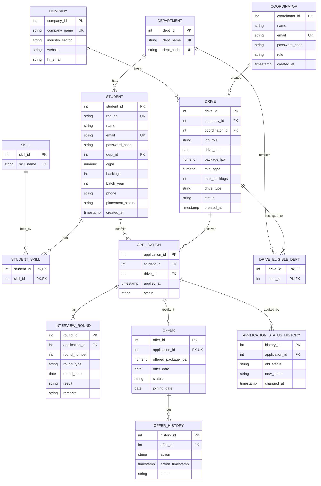

# ER Diagram — College Placement Management System

13 tables, matching `db/schema.sql` (checked against the live database's
`information_schema.columns`; full column/constraint listing in
`docs/evidence/schema-summary.md`). A rendered PNG of this exact diagram is
`docs/evidence/er-diagram.png`.

Render this directly on GitHub, in VS Code (Markdown Preview Mermaid Support
extension), or at https://mermaid.live.

## Allowed values (CHECK constraints)

Kept out of the diagram so it stays legible on an A4 page. Each list is a
`CHECK (... IN (...))` constraint in `db/schema.sql`.

| Column | Allowed values |
|---|---|
| `student.placement_status` | Not Placed, Placed |
| `coordinator.role` | TPO, Coordinator |
| `drive.drive_type` | Full-Time, Internship |
| `drive.status` | Upcoming, Ongoing, Completed, Cancelled |
| `application.status` | Applied, Shortlisted, Interview_Scheduled, Rejected, Selected, Offer_Made |
| `interview_round.round_type` | Aptitude, Technical, HR, Group_Discussion, Coding_Test |
| `interview_round.result` | Pass, Fail, Pending |
| `offer.status` | Pending, Accepted, Declined |
| `offer_history.action` | Created, Accepted, Declined |

## Entity list with cardinalities (plain-English, for the viva)

| Relationship | Cardinality | Notes |
|---|---|---|
| Department — Student | 1 : N | Every student belongs to exactly one department. |
| Department — Drive (via Drive_Eligible_Dept) | M : N | A drive can be restricted to multiple departments; a department can be targeted by multiple drives. Zero rows for a drive = open to all departments. |
| Student — Skill (via Student_Skill) | M : N | A student has many skills; a skill is held by many students. |
| Company — Drive | 1 : N | A company can run many drives (across years/roles); each drive belongs to one company. |
| Coordinator — Drive | 1 : N | A coordinator/TPO creates many drives; each drive has one creator (nullable — a drive could be system/seed-created). |
| Student — Application | 1 : N | A student can submit many applications (to different drives). |
| Drive — Application | 1 : N | A drive receives many applications (from different students). |
| **Student — Drive (via Application)** | **M : N** | The actual M:N relationship the spec calls out — Application is the resolving junction/associative entity, carrying its own attributes (applied_at, status). |
| Application — Interview_Round | 1 : N | An application goes through zero or more interview rounds. |
| Application — Offer | 1 : 0..1 | An application results in at most one offer (enforced by UNIQUE(application_id) on Offer). |
| Offer — Offer_History | 1 : N | Every state change to an offer (Created/Accepted/Declined) appends one audit row. |
| Application — Application_Status_History | 1 : N | Every status change of an application appends one row. Written only by the trigger `trg_application_status_audit`, never by application code. |

## Which tables the database maintains by itself

Some rows and columns are written by triggers, not by the backend, so they
stay correct even if someone edits the data directly in SQL:

| Written by | What it writes |
|---|---|
| `trg_offer_after_insert` | `student.placement_status` → `Placed` when a (non-Declined) offer is inserted |
| `trg_application_status_audit` | one `application_status_history` row per status change |
| `sp_close_drive` (procedure) | `drive.status` → `Completed`, pending applications → `Rejected` |

And four BEFORE triggers refuse rows that break a rule (error codes PL001–PL007,
evidence in `docs/evidence/triggers.md`): `trg_application_before_insert`,
`trg_offer_before_accept`, `trg_offer_requires_selected`,
`trg_application_status_transition`.

## Why Application resolves Student↔Drive (not Student↔Company directly)

A company runs many drives over time (different roles, different years, different eligibility cutoffs and packages). A student applies to one specific posting, not generically to "Infosys" — so `Application.drive_id` is the correct FK, and the Student↔Company relationship is still fully queryable by joining through Drive → Company. Modeling it as `Application.company_id` directly would lose which specific drive was applied to, or require carrying both FKs redundantly.
